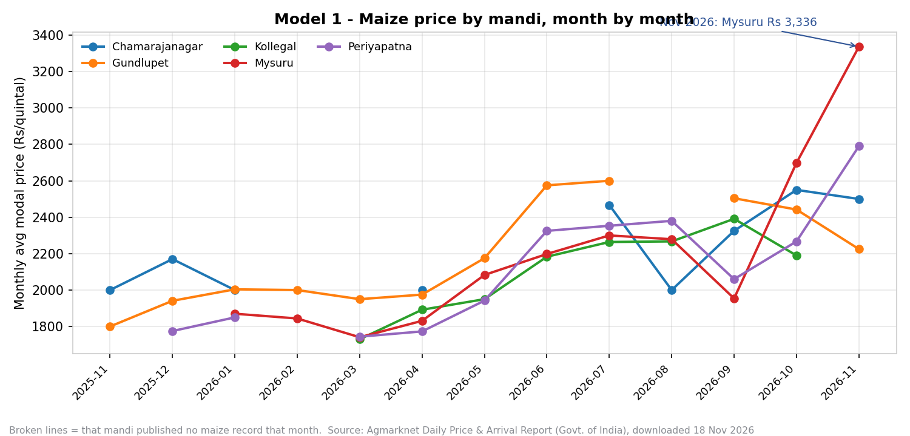
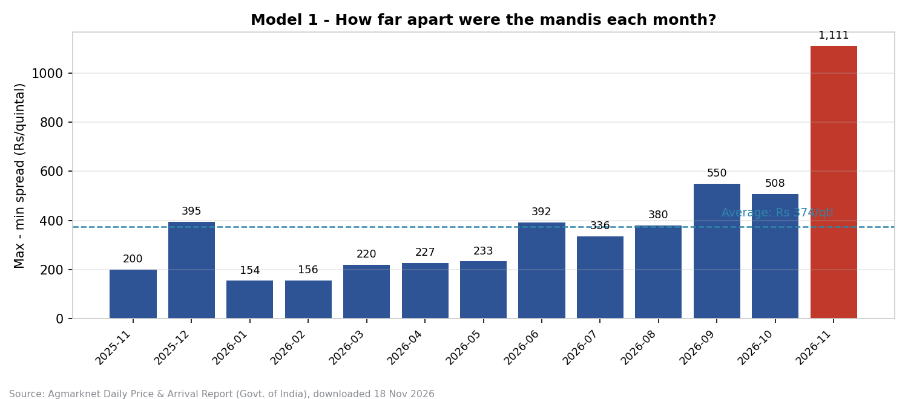
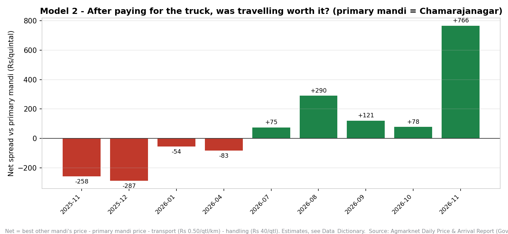
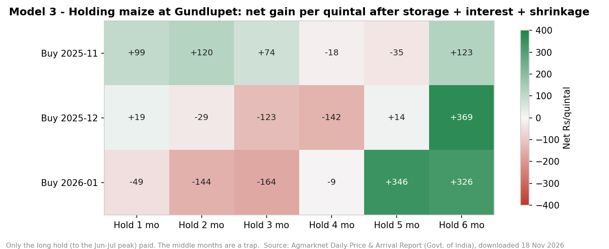
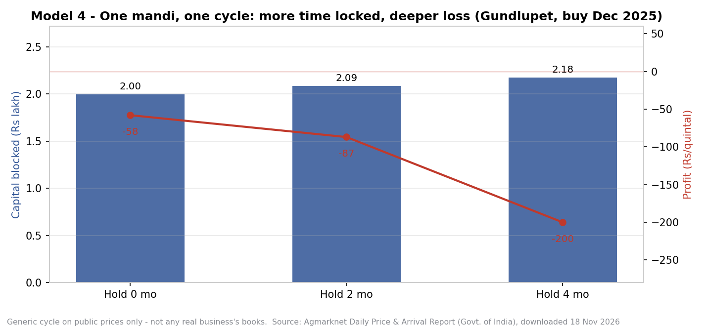
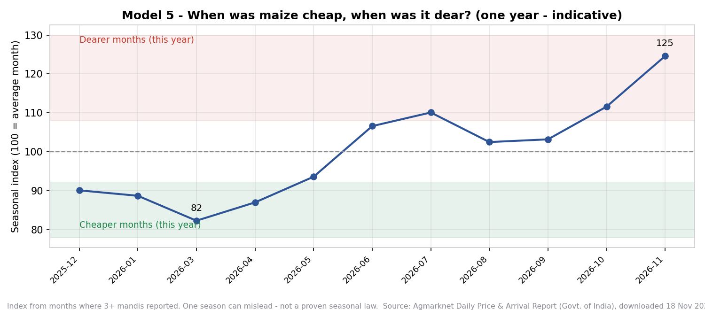

# Agri Mandi Spread & Procurement Analysis — Maize, Karnataka APMCs

By **Vignesh V** — MBA (Finance & Operations), Seshadripuram College, Bengaluru City University
· [LinkedIn](https://www.linkedin.com/in/vignesh-v-033762354/)
· Project `05` of my finance-ops portfolio, alongside `01-monte-carlo-safety-stock`

## The problem

A commodity trader in Chamarajanagar district buys and sells maize across nearby mandis.
Two questions decide whether he makes money, and both are usually answered by gut feel:

1. **Where to sell?** The same maize, on the same day, trades at different prices in
   Chamarajanagar, Gundlupet, Kollegal, Mysuru and Periyapatna. Is the higher price in
   another mandi still higher after paying for the truck?
2. **When to buy, hold and sell?** Prices swing through the season. Holding stock costs
   money every month — godown rent, interest on the cash locked in the stock, and
   quality/shrinkage loss. How long can you hold before the cost eats the price rise?

This project answers both with one year of real, public price data — no estimates
presented as prices, no filled gaps.

## Data

- **Source:** Agmarknet (Government of India) Daily Price & Arrival Report, downloaded
  18 Nov 2026.
- **Period:** 18 Nov 2025 – 17 Nov 2026. **381 daily records.**
- **Markets:** Chamarajanagar APMC (17 records), Gundlupet APMC (78), Kollegal APMC (53),
  Mysuru APMC (135), Periyapatna APMC (98).
- **Fields:** date, mandi, variety, grade, min/max/modal price (₹/quintal), modal ₹/kg
  (= ₹/qtl ÷ 100, because local trade quotes per kg), arrivals (quintals).
- Small mandis report patchily. A missing date means the mandi published no maize record
  that day. **Missing values are left empty — never copied from a neighbour mandi,
  never interpolated.**

## Method — five models, one workbook

File: `maize_spread_model_v1.xlsx` — the raw data travels inside it, on the
`Raw_Data` sheet, so every number in the models can be traced back to its source row.
One workbook only: the Dashboard sheet carries all six charts, and each model sheet
carries its own chart again next to its numbers.

1. **Mandi spread (Model 1).** Monthly average modal price per mandi; each mandi's spread
   vs the primary mandi (Chamarajanagar) as live Excel formulas, plus the month's max–min
   spread in ₹/qtl and ₹/kg.
2. **Net spread (Model 2).** The spread after actually moving the grain: subtracts
   transport at ₹0.50/qtl/km + ₹40/qtl handling (labelled estimates), using approximate
   road distances from Chamarajanagar — Gundlupet 36 km, Kollegal 39 km, Mysuru 61 km,
   Periyapatna 100 km. Gross spread is a headline; net spread is the decision.
3. **Holding cost (Model 3).** Buy at a harvest month's average (Nov/Dec/Jan), sell
   1–6 months later. Net = price gain − months × (storage ₹15/qtl/month + interest
   1%/month of buy price + shrinkage 0.5%/month of buy price). All three cost rates are
   labelled assumptions.
4. **Working capital (Model 4).** A generic 100-quintal trader cycle on public prices
   only: buy at Gundlupet's Dec-2025 average (₹1,941/qtl), add ₹58/qtl
   transport+handling, then sell now vs hold 2 vs hold 4 months. Shows capital blocked,
   cycle days, profit per quintal and per cycle, and the return per cycle on the capital
   blocked (per cycle, not annualised — annualising a 15-day cycle would exaggerate it).
5. **Procurement timing (Model 5).** Each mandi's cheapest month (buy window) and
   costliest month (sell window), plus a seasonal index (month's cross-mandi average ÷
   the average of those monthly averages × 100) for months where 3+ mandis reported,
   read against monthly arrivals.

## Charts — one visual per model

**Model 1 — price by mandi, and the monthly spread between mandis:**

Broken lines in the price chart are honest: that mandi published no maize record that
month (see Data quality below).

**Model 2 — net spread: after transport, was travelling worth it?**

**Model 3 — holding cost heatmap (Gundlupet):**

**Model 4 — working capital: capital blocked vs profit per cycle:**

**Model 5 — seasonal index (one year, indicative):**

## Headline findings

- **Place matters, month matters more.** Average monthly max–min spread across mandis:
  **₹374/quintal (₹3.74/kg)**. Widest: Nov 2026, **₹1,111/qtl** (Mysuru avg ₹3,336 vs
  Gundlupet ₹2,225).
- **After transport, travelling paid only in the second half of the year.** Of the 9 months
  where the primary mandi reported, selling in the best alternative mandi was profitable in
  5 months (Jul–Nov) and a loss in 4 (Dec–Apr). Best single month: Nov 2026 to Mysuru,
  **+₹766/qtl net**. Gundlupet topped the price table in 7 of 13 months; Kollegal never did.
- **Short holds destroyed value; only the long hold paid.** At Gundlupet, holds of
  2–4 months averaged negative (prices dipped Mar–Apr). A 6-month hold to the Jun–Jul
  peak averaged **+₹273/qtl** after all holding costs. At Mysuru only 4–6 month holds
  paid (+₹41 to +₹172/qtl) — but that rests on a single buy month, so it is indicative.
- **A buy–hold–sell cycle at one mandi lost money in every scenario tested.** Buying at
  Gundlupet in Dec 2025 and selling back at Gundlupet: −₹58/qtl selling immediately
  (−2.9% on the ~₹2.00 lakh blocked for 15 days), −₹87/qtl holding 2 months (−4.2%,
  75 days), −₹200/qtl holding 4 months (−9.2%, 135 days). The cycle only pays when
  combined with a mandi switch or a peak-month sale.
- **Timing windows (one year only):** cheapest cross-mandi months were Mar 2026
  (seasonal index 82), Jan 2026 (89) and Dec 2025 (90); costliest were Nov 2026 (125),
  Oct 2026 (112) and Jul 2026 (110). Reported arrivals showed **no clear relationship**
  with price this year (correlation ≈ 0.03 across the 11 months where 3+ mandis
  reported — the working is shown on the workbook's Procurement_Timing sheet) —
  arrivals reporting is itself patchy.

## Data quality & verification

- **Completeness was re-verified on 18 Nov 2026.** The two sparse mandis were re-queried
  on Agmarknet three ways (full-year, period chunks, variety-specific). Chamarajanagar's
  chunk counts (6 + 1 + 1 + 6 + 3) sum to exactly its full-year count of 17; Kollegal
  returned an explicit "No data available" for every month from Nov 2025 to Feb 2026 —
  its reporting genuinely starts 16 Mar 2026. The dataset is complete against what the
  portal published; the gaps are the source's reporting pattern, not missing extraction.
- **Flagged, not removed:** Gundlupet's 12 Nov 2026 modal price of ₹1,176/qtl is a sharp
  one-day outlier (₹3,000 on 5 Nov) and pulls its Nov-2026 average down. Mysuru shows
  flat multi-day price plateaus that look like reporting artefacts. Both are documented
  on the workbook's Data_Quality sheet.
- **Sensitivity check on the headline (on the Data_Quality sheet):** the widest spread
  (Nov 2026, ₹1,111/qtl) rests partly on Gundlupet's 3-record month. Removing the
  outlier narrows it to ₹586; using medians instead of means gives ₹850. The
  decision-relevant figure — the net gain from selling at Mysuru instead of the primary
  mandi — is stable: +₹766/qtl on means, +₹780 on medians. The verdict does not depend
  on the outlier; only the exact width of the spread does.
- A full field-by-field data dictionary and the assumption register are on the
  workbook's Data_Dictionary sheet.

## Caveats — read before quoting any number

- **One year of data.** Every "window" and "pattern" above is one season's behaviour,
  not a proven seasonal law.
- **Thin months count the same as full ones.** Monthly averages are simple averages of
  daily modal prices, not weighted by arrivals (arrivals reporting is too patchy to
  weight reliably). The primary mandi itself, Chamarajanagar, reported only 17 days in
  the year, so some of its monthly averages rest on 1–3 records; record counts are
  shown on the Monthly_Avg sheet.
- **Varieties are not identical across mandis:** Chamarajanagar/Gundlupet/Mysuru report
  Local/Local, Kollegal reports Local/**Non-FAQ**, Periyapatna reports
  **Hybrid/Local, FAQ**. Cross-mandi spreads mix variety and location effects.
  Within-mandi comparisons (holding, timing) are like-for-like.
- **Cost rates are assumptions, labelled as such on every sheet** (transport ₹0.50/qtl/km,
  handling ₹40/qtl, storage ₹15/qtl/month, interest 12% p.a., shrinkage 0.5%/month).
  Change them and the verdicts move — the workbook is built so they can be changed.
- **Working capital model is generic.** It uses public mandi prices only. It is not any
  real business's books, margins or volumes.

## Tools

Microsoft Excel (the five models, live formulas in the spread sheet, charts),
Python (data cleaning and chart generation), Agmarknet (data source).

## Possible next steps

- Add 2–3 more years of Agmarknet history to test whether the timing windows repeat.
- Rebuild the same models in SQL + a Power BI dashboard.
- Extend to ragi, paddy and groundnut (same layout already supports them).
